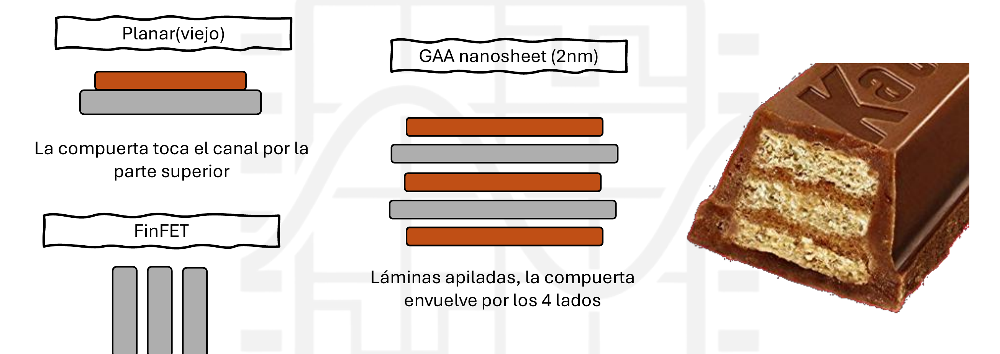

<!-- layout: portada -->
## Antes del primer postre…
# Sesión 1 · PDKs y Linux para VLSI


<!-- notas:
Bienvenida al curso. Hoy no diseñamos todavía: preparamos la cocina.
Primero vemos el recetario completo (qué vamos a hacer en 12 horas), luego la masa madre
de todo chip (el PDK) y al final los hornos e instrumentos con los que vamos a trabajar
(Linux, Docker y git). En la práctica cada quien deja su contenedor, su repo y sus notas del PDK.
-->

---

<!-- layout: contenido -->
<!-- color: morado -->
# ¿Qué te llevas en 12 horas?

- **Un chip de verdad:** el semáforo, del RTL al GDSII
- Con **DRC y LVS limpios** y el **timing firmado**
- El flujo completo con herramientas abiertas: las mismas ideas que Synopsys o Cadence
- Un repo en GitHub con tu trabajo de las 6 sesiones
- Opcional: **tu propio diseño** como proyecto final evaluable

> Un solo diseño de punta a punta: la salida de cada sesión es la entrada de la siguiente

<!-- notas:
Insistir en la idea de continuidad: el netlist de la sesión 4 sale del RTL de la sesión 2,
el GDS de la sesión 5 sale de ese netlist, y en la sesión 6 se firma ese mismo GDS.
Si alguien se atora, la rama soluciones le permite seguir con la siguiente etapa.
-->

---

<!-- layout: diagrama -->
<!-- color: negro -->
# El flujo de punta a punta


> La mitad del curso es physical design: síntesis, place & route y STA

<!-- notas:
Recorrer de izquierda a derecha. En azul el front-end (sesiones 2 y 3): describir y verificar.
En morado el back-end o physical design (sesiones 4 a 6): convertir la descripción en geometría
que la fábrica pueda hacer. El PDK alimenta todas las etapas de implementación: por eso hoy empezamos por él.
-->

---

<!-- layout: contenido -->
<!-- color: rosa -->
# Seis sesiones, seis postres

| Sesión | Postre | Tema | Te llevas |
| --- | --- | --- | --- |
| 1 | Hornos y masa madre | PDK y Linux | Tu repo y tus notas del PDK |
| 2 | Churros | RTL y FSM | Semáforo con botón peatonal |
| 3 | Flan (y Gelatina) | Verificación | PASS + test aleatorio |
| 4 | Polvorones | Síntesis | Netlist SKY130 + GLS |
| 5 | Tres Leches | Place & Route | El GDS del semáforo |
| 6 | Cajeta | STA y signoff | Checklist de signoff |

<!-- notas:
Cada sesión es una hora de teoría y una de práctica. La de hoy es la única que no es un postre:
es la infraestructura con la que se hacen todos los demás.
La Gelatina (verificación formal) aparece 10 minutos dentro de la sesión 3.
-->

---

<!-- layout: contenido -->
<!-- color: cian -->
# ¿Quién hace qué en un equipo de chips?

| Rol | Qué hace | Lo vives en |
| --- | --- | --- |
| Flow Engineer | Prepara el PDK, las herramientas y los scripts | Sesión 1 |
| RTL Designer | Escribe el RTL a partir de la especificación | Sesión 2 |
| DV Engineer | Demuestra que el RTL cumple la especificación | Sesión 3 |
| Synthesis Engineer | Convierte el RTL en celdas del PDK cuidando el PPA | Sesión 4 |
| PDE (Physical Design) | Floorplan, PDN, placement, CTS y routing | Sesión 5 |
| PVE (Physical Verification) | DRC, LVS y antena: que la fábrica lo acepte | Sesión 6 |

<!-- notas:
En una empresa cada rol es un equipo distinto; en este curso cada quien juega todos.
Hoy somos Flow Engineers: dejamos listo el PDK y las herramientas para todo el equipo.
-->

---

<!-- layout: seccion -->
<!-- color: negro -->
## Como la masa madre…
# El PDK, un trato con el diablo

> Sin PDK no hay chip que la fábrica acepte

<!-- notas:
Arranca el bloque del PDK (25 minutos). La masa madre es la base de toda la panadería:
cada pan la usa. El PDK es la base de cada etapa del flujo.
-->

---

<!-- layout: contenido -->
<!-- color: negro -->
# ¿Qué es un PDK?

- **El contrato con la fábrica:** define qué puedes construir y cómo describírselo a las herramientas
- Reglamento de construcción + catálogo de materiales + mapa de lo que la fábrica puede hacer
- Sin PDK puedes dibujar lo que sea, pero ninguna fábrica aceptará tus diseños rancios

> La masa madre: sin esta base no hay rico pan dulce

<!-- notas:
PDK = Process Design Kit. Lo entrega la fundidora (aquí SkyWater, para su proceso de 130 nm).
Los PDKs comerciales vienen bajo NDA; SKY130 es abierto, por eso lo podemos usar y estudiar completo.
-->

---

<!-- layout: contenido -->
<!-- color: morado -->
# ¿Qué trae un PDK?

| Pieza | ¿Qué es? | ¿A qué etapa alimenta? |
| --- | --- | --- |
| .lib | Timing y potencia de cada celda | Síntesis, STA |
| .lef | Geometría abstracta de cada celda | PnR |
| GDS de la celda | El layout real de cada celda | Ensamble del GDS |
| tech / layer map | Capas de fabricación | Layout, PEX |
| DRC / LVS decks | Reglas que la fábrica exige | Signoff |
| Modelos SPICE | Comportamiento eléctrico de los transistores | Flujo analógico |
| Corners PVT | Peor y mejor caso | STA y simulación analógica |

<!-- notas:
Cada renglón es una vista distinta del mismo conjunto de celdas: la herramienta que la consume
solo necesita lo suyo. Síntesis no necesita el layout; PnR no necesita los transistores.
-->

---

<!-- layout: diagrama -->
<!-- color: morado -->
# Cada vista alimenta una etapa

- Cada herramienta lee **solo la vista que necesita**
- Síntesis ve números (`.lib`), PnR ve cajas (`.lef`), la fábrica ve polígonos (GDS)
- Los corners PVT son varias copias del `.lib`


<!-- notas:
Idea clave: la misma celda nand2_1 aparece en todos estos archivos, cada uno con un nivel de detalle distinto.
En las sesiones 4 a 6 vamos a ir tocando estas vistas una por una.
-->

---

<!-- layout: diagrama -->
<!-- color: cian -->
# open_pdks por dentro: libs.ref y libs.tech


> Nosotros vivimos en libs.ref/sky130_fd_sc_hd/: ahí están las vistas de nuestras celdas

<!-- notas:
open_pdks es el proyecto que "procesa" el PDK crudo de SkyWater y genera estas carpetas para cada herramienta.
En el contenedor está en /foss/pdks; en la práctica lo recorremos con ls.
-->

---

<!-- layout: codigo -->
<!-- color: verde -->
# La librería sky130_fd_sc_hd

```bash Open Source — ciel + bash
ciel ls --pdk-family sky130 --pdk-root /foss/pdks
# └── 1689ac3f… (2026.08.27) (enabled)

source scripts/env.sh
ls $SCL_DIR
# cdl  gds  lef  lib  mag  maglef  spice  techlef  verilog

grep -c 'cell ("sky130' $LIB_TT
# 428
```

- `ciel`: el gestor de versiones del PDK
- El hash dice **exactamente** qué PDK usas
- 428 celdas: compuertas, flip-flops, buffers, celdas físicas

<!-- notas:
El hash es lo que pondrías en el README de un proyecto para que otro reproduzca tus resultados.
Todos en el salón tienen el mismo porque todos usan la imagen 2026.09.
En la práctica cuentan las celdas y los corners ellos mismos.
-->

---

<!-- layout: diagrama -->
<!-- color: rosa -->
# ¿Cómo se lee el nombre de una celda?


> El doble guion bajo `__` separa la librería de la celda: `sky130_fd_sc_hd` + `__` + `nand2_1`

<!-- notas:
Preguntar al grupo: ¿qué será un inv_4? ¿un dfrtp_1? (d flip-flop, reset, true output, positive edge).
La fuerza (_1, _2, _4) dice cuánta corriente puede entregar: más fuerza, más área.
-->

---

<!-- layout: codigo -->
<!-- color: verde -->
# Una celda por dentro: nand2_1

```bash pdk_info.sh — lo construyes en la práctica
./pdk_info.sh nand2_1
# Celda   : sky130_fd_sc_hd__nand2_1
# Corner  : tt_025C_1v80
# Área    : 3.7536 µm²                (.lib)
# Tamaño  : 1.38 x 2.72 µm  = 3 sitios unithd   (.lef)
# Pines   : A B VGND VNB VPB VPWR Y   (.lef)
```

- **Todas** miden 2.72 µm de alto: así caben en filas
- El ancho es un múltiplo del sitio: 0.46 µm
- 4 pines de alimentación en cada celda

<!-- notas:
Mostrar la celda en vivo en KLayout (make klayout CELDA=nand2_1): los rieles de met1 arriba (VPWR)
y abajo (VGND), el polisilicio vertical de las dos compuertas y los pines A, B, Y.
El área sale del .lib; el tamaño y los pines, del .lef: dos vistas de la misma celda.
-->

---

<!-- layout: contenido -->
<!-- color: negro -->
# Corners PVT: el mismo chip en otro mundo

| Corner | Proceso | Temperatura | Voltaje | Para qué |
| --- | --- | --- | --- | --- |
| tt_025C_1v80 | típico | 25 °C | 1.80 V | Resultados "normales" |
| ss_100C_1v60 | lento | 100 °C | 1.60 V | Setup: ¿alcanza el reloj? |
| ff_n40C_1v95 | rápido | −40 °C | 1.95 V | Hold: ¿llega demasiado pronto? |

> El nombre del .lib es proceso_temperatura_voltaje

<!-- notas:
La fábrica no hace dos chips iguales: los transistores salen más rápidos o más lentos (proceso),
y el chip trabaja caliente o frío, con más o menos voltaje. El .lib se caracteriza para cada combinación.
En la sesión 6 firmamos setup en ss y hold en ff. La librería trae más corners; estos tres son los del curso.
-->

---

<!-- layout: contenido -->
<!-- color: rosa -->
# El último grito de la moda: GT2N (2 nm)

| Pieza | SKY130 | GT2N |
| --- | --- | --- |
| Nodo | 130 nm | 2 nm |
| Transistor | Planar | Nanosheet GAA |
| Energía | Por el frente | Por detrás (BSPDN) |

> La idea de PDK es la misma; lo que cambia es el transistor de adentro

<!-- notas:
GT2N es un PDK abierto de investigación: 72 celdas estándar, multi-VT, transistores GAAFET nanosheet
y alimentación por detrás de la oblea. Sirve para asomarse a la tecnología actual, aunque sea teórico.
-->

---

<!-- layout: diagrama -->
<!-- color: cian -->
# ¿Por qué los transistores parecen un KitKat?



> Más control del canal: menos fugas, más rápido y más eficiente

<!-- notas:
Planar: la compuerta toca el canal solo por arriba. FinFET: aletas paradas, la compuerta abraza por 3 lados.
GAA nanosheet: láminas apiladas, la compuerta envuelve por los 4 lados, como el chocolate a las obleas del KitKat.
SKY130 es planar; por eso es barato y abierto, y por eso sirve para aprender.
-->

---

<!-- layout: seccion -->
<!-- color: verde -->
## Sin horno no hay pan…
# Hornos e instrumentos de cocina

> Linux, Docker y git: la infraestructura con la que se hace cada postre

<!-- notas:
Arranca el bloque de infraestructura (25 minutos). No es un postre: son el horno, la batidora
y el recetario donde anotamos todo.
-->

---

<!-- layout: diagrama -->
<!-- color: verde -->
# Tu cocina: Docker + iic-osic-tools


> Detén e inicia tu contenedor; nunca lo borres. Tu respaldo es git push

<!-- notas:
La imagen iic-osic-tools trae todas las herramientas y el PDK ya instalados: nadie pierde una tarde compilando.
Docker Desktop la corre como un contenedor; el escritorio se abre en el navegador (localhost:8080, abc123).
Todos con la misma versión, 2026.09. Dar Run otra vez a la imagen crea un contenedor nuevo y vacío:
las siguientes veces se usa el botón de iniciar del mismo contenedor.
-->

---

<!-- layout: contenido -->
<!-- color: cian -->
# ¿Por qué Linux en VLSI?

- Las herramientas de EDA (Synopsys, Cadence, Siemens y las abiertas) corren en Linux
- **Todo es texto:** netlists, `.lib`, LEF, DEF y reportes se buscan con `grep`, `awk` y `sed`
- **Todo se automatiza:** un flujo es una cadena de scripts (Make, bash, Tcl)
- Se trabaja en servidores remotos, con licencias compartidas, desde una terminal

> El ingeniero de chips vive en la terminal

<!-- notas:
Ejemplo: en la práctica sacan el área de una celda de un archivo de miles de líneas con un solo comando.
Nadie abre un .lib en un editor para buscar a mano.
-->

---

<!-- layout: codigo -->
<!-- color: negro -->
# La shell en 10 comandos

```bash
pwd                  # ¿dónde estoy?
ls -la               # ¿qué hay aquí?
cd ../../common      # moverse
mkdir -p a/b/c       # crear carpetas
cp  mv  rm           # copiar, mover, borrar
less archivo         # leer (q = salir)
find .. -name "*.v"  # buscar archivos
grep -n module *.v   # buscar texto
wc -l archivo        # contar líneas
cmd1 | cmd2          # encadenar
```

- `.` aquí · `..` arriba · `~` tu home
- El `|` es el superpoder: armas un comando pieza por pieza

<!-- notas:
El pipe es lo que usan en la práctica para construir pdk_info.sh: grep, luego grep, luego head, awk y tr,
viendo la salida en cada paso. Advertir sobre "cmd > archivo": vacía el archivo aunque el comando falle.
-->

---

<!-- layout: codigo -->
<!-- color: morado -->
# Variables de entorno: PATH, PDK_ROOT, PDK

```bash
echo $PATH         # dónde busca programas
which klayout      # → /foss/tools/bin/klayout

echo $PDK_ROOT     # ¿y el PDK? (puede fallar)
source scripts/env.sh
# >> PDK_ROOT = /foss/pdks

echo $LIB_TT       # el .lib típico, sin
                   # escribir la ruta a mano
```

- Una variable guarda una ruta **una vez**
- `env.sh` busca el PDK y fija todas las rutas del curso
- `source` = que las variables se queden en tu terminal

<!-- notas:
En algunas versiones del contenedor PDK_ROOT apunta a una carpeta sin el PDK: env.sh lo detecta y lo corrige.
Diferencia entre ejecutar un script (corre en otro proceso) y hacerle source (cambia tu terminal).
-->

---

<!-- layout: diagrama -->
<!-- color: rosa -->
# Rutas absolutas y relativas


> Absoluta: empieza en / y solo sirve en tu máquina · Relativa: desde tu lab, ../../common/sdc/semaforo.sdc

<!-- notas:
Cada ../ sube un nivel. Desde labs/lab01-linux-pdk, dos ../ llegan a la raíz del repo y de ahí bajas a common.
Por eso todos los Makefiles del curso funcionan sin importar dónde clonaste el repo.
-->

---

<!-- layout: contenido -->
<!-- color: cian -->
# Cómo se organiza un proyecto de chip

| Carpeta | Qué guarda | Herramienta | Lenguaje |
| --- | --- | --- | --- |
| rtl/ | El diseño | — | Verilog |
| tb/ | Testbench y pruebas | Icarus, cocotb | Verilog, Python |
| syn/ | Netlist y reportes de síntesis | Yosys | Script de Yosys |
| pnr/ | Layout: DEF, GDS | OpenROAD, LibreLane | Tcl, JSON |
| sta/ | Restricciones y timing | OpenSTA | SDC (Tcl) |

> Make orquesta, bash pega, Tcl le habla a las herramientas

<!-- notas:
Es la misma estructura que se pide en el proyecto final. Cada lab del curso corre con make desde su carpeta:
no hay que acordarse de comandos largos.
-->

---

<!-- layout: diagrama -->
<!-- color: verde -->
# Git, la bitácora del chip


> Cada lab termina con git push: es tu bitácora y tu respaldo

<!-- notas:
Fork: tu copia en GitHub, donde sí puedes escribir. Clone: esa copia en tu contenedor.
Tu rama alumno/tu-nombre guarda tus labs. Al inicio de cada sesión, git pull upstream main trae los labs nuevos.
Para el push se usa el token, no la contraseña.
-->

---

<!-- layout: contenido -->
<!-- color: negro -->
# ¿Qué sí y qué no se sube a git?

| Sí se sube | No se sube nunca |
| --- | --- |
| RTL, testbenches, scripts y Makefiles | El PDK (son GB y no es tuyo) |
| SDC, config.json y README | Material bajo NDA (PDKs comerciales) |
| Notas y reportes pequeños | Lo que se regenera: .vcd, runs/, .odb, .gds |

> El .gitignore decide: revísalo antes de tu primer commit

<!-- notas:
Regla práctica: si se regenera con make, no va en git. El .gitignore del repo ya excluye todo eso.
En la industria, subir un archivo bajo NDA a un repo público puede costar el trabajo.
-->

---

<!-- layout: cierre -->
## ¡A la cocina!
# Práctica de hoy

- Contenedor, fork y tu rama `alumno/<tu-nombre>`
- 8 retos de rutas y tu primer `git push`
- `pdk_info.sh`: área, tamaño y pines de una celda
- Entrega: `make entrega` → LISTO
- Próxima sesión: **Churros**, RTL y FSM

<!-- notas:
La práctica está en labs/lab01-linux-pdk/README.md. Las partes marcadas [Juntos] se hacen al mismo tiempo
en el proyector. Recordar: detener el contenedor, no borrarlo, y hacer push antes de irse.
-->
