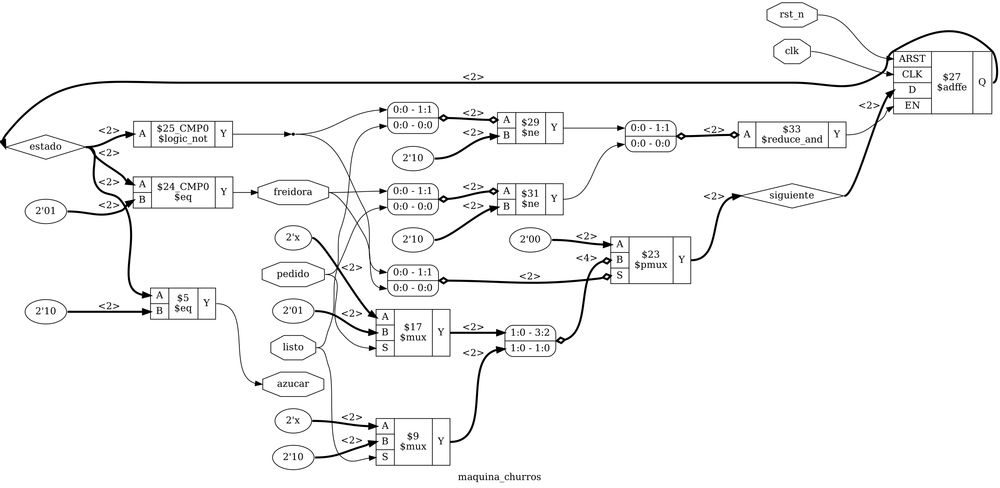

<!-- layout: portada -->
## Moldeándose como churro…
# Sesión 2 · RTL sintetizable y FSM


<!-- notas:
Hoy escribimos hardware por primera vez. La meta: al salir, cada quien escribe una máquina de estados
sintetizable, sin latches, y la pasa por lint en cero warnings.
Teoría: 10 min de "describir no es programar", 20 de subconjunto sintetizable, 20 de FSM y 10 de buenas prácticas.
-->

---

<!-- layout: contenido -->
<!-- color: morado -->
# ¿Qué te llevas hoy?

- Leer un RTL y encontrar sus **4 piezas**
- Saber qué del Verilog se vuelve **hardware** y qué es solo para simular
- Reconocer y evitar un **latch** que nadie pidió
- Pasar tu RTL por **lint** (Verilator) y ver qué **hardware** entiende Yosys
- Agregarle una entrada al semáforo: el **botón peatonal**

> Entregable: semáforo con ped_req, lint en cero, sin latches, en tu rama

<!-- notas:
Recordar dónde estamos en el flujo: sesión 2 es el inicio del front-end. Lo que escriban hoy es lo que
se verifica en la sesión 3, se sintetiza en la 4 y termina como GDS en la 5.
Por eso el RTL tiene que estar limpio: cada warning de hoy es un problema más caro mañana.
-->

---

<!-- layout: seccion -->
<!-- color: negro -->
## Moldeándose como churro…
# Diseño RTL, el qué no el cómo

> Describir hardware no es programar

<!-- notas:
Bloque A, 10 minutos. El cambio de chip mental más importante del curso.
-->

---

<!-- layout: contenido -->
<!-- color: verde -->
# ¿Qué es describir hardware?

- Le dices al chip **qué comportamiento** quieres, no con qué compuertas
- Verilog es un lenguaje de **descripción**: todo ocurre **a la vez**, no línea por línea
- Todavía no hay silicio ni celdas del PDK: es la **receta**, no el horneado
- Entra la especificación; sale un RTL `.v` **sintetizable**

> "Dime cómo debe comportarse tu circuito y te daré el hardware que lo haga"


<!-- notas:
El churro: masa que sale extruida en tiras largas y uniformes. Le das la forma a la masa (el comportamiento),
pero todavía no la fríes. La fritura es la síntesis de la sesión 4: ahí aparecen las celdas de SKY130.
-->

---

<!-- layout: diagrama -->
<!-- color: cian -->
# Software contra hardware


> En hardware, tres líneas de código son tres circuitos trabajando al mismo tiempo

<!-- notas:
En software, el procesador ejecuta una instrucción y luego la siguiente: el orden es tiempo.
En hardware, el sumador, el multiplicador y el restador existen físicamente y trabajan siempre.
El orden en el que escribes los bloques always en el archivo no importa: todos corren en paralelo.
Pregunta para el grupo: ¿qué pasa si dos bloques always asignan la misma señal? (dos circuitos manejando el mismo cable).
-->

---

<!-- layout: diagrama -->
<!-- color: morado -->
# RTL = Register Transfer Level

- **Registros:** flip-flops que guardan datos en cada flanco de reloj
- **Lógica combinacional:** lo que pasa entre registro y registro
- El reloj marca **cuándo** se guarda; la lógica decide **qué** se guarda


> Todo diseño digital síncrono es esto, repetido miles de veces

<!-- notas:
El nombre lo dice: describimos cómo se transfieren los datos de registro a registro en cada ciclo.
Este dibujo es exactamente lo que STA va a analizar en la sesión 6: rutas de registro a registro,
que deben caber en un periodo de reloj (20 ns en este curso).
-->

---

<!-- layout: seccion -->
<!-- color: negro -->
## La masa tiene reglas
# El subconjunto sintetizable

> No todo lo que compila se puede fabricar

<!-- notas:
Bloque B, 20 minutos: combinacional contra secuencial, bloqueante contra no bloqueante, latches y reset.
-->

---

<!-- layout: codigo -->
<!-- color: cian -->
# Lógica combinacional

```verilog assign: una ecuación
assign mayor = (a > b);
assign y     = sel ? a : b;      // un mux
```

```verilog always @(*): lo mismo, con if y case
always @(*) begin
    y = b;                       // valor por defecto
    if (sel) y = a;
end
```

- La salida depende **solo** de las entradas de **ahora**
- `@(*)`: se reevalúa cuando cambia cualquier entrada
- Se asigna con **`=`**
- No recuerda nada: no hay reloj

<!-- notas:
assign es para ecuaciones de una línea; always @(*) cuando hace falta if o case.
Las dos producen el mismo hardware: compuertas y multiplexores.
Ojo: reg en Verilog NO significa registro. Es solo el tipo de variable que se puede asignar dentro de un always.
Qué hardware sale lo decide el always, no la palabra reg.
-->

---

<!-- layout: codigo -->
<!-- color: morado -->
# Lógica secuencial

```verilog always @(posedge clk or negedge rst_n)
always @(posedge clk or negedge rst_n) begin
    if (!rst_n)
        cuenta <= 4'd0;          // reset: valor conocido
    else if (en)
        cuenta <= cuenta + 4'd1; // en cada flanco con en = 1
end
```

- Cambia **solo** en el flanco de subida de `clk`
- Recuerda su valor entre flancos: son **flip-flops**
- Se asigna con **`<=`**
- `rst_n` va en la lista: reset **asíncrono**

<!-- notas:
Este contador de 4 bits son 4 flip-flops con reset asíncrono y una lógica de suma entre ellos.
Si en = 0 no se asigna nada: está bien, en un bloque secuencial el flip-flop simplemente conserva su valor.
Eso es justo lo que en un bloque combinacional sería un latch: el mismo "no asignar" significa cosas distintas.
-->

---

<!-- layout: diagrama -->
<!-- color: negro -->
# ¿Qué hardware sale de cada bloque?


> El tipo de always decide el hardware; reg no significa registro

<!-- notas:
Esto es lo que van a ver con make show en la práctica: cajas $mux, $eq y $pmux para lo combinacional,
cajas $adff y $adffe para los flip-flops con reset asíncrono. Los números entre picos son el ancho en bits.
-->

---

<!-- layout: codigo -->
<!-- color: rosa -->
# Bloqueante (=) contra no bloqueante (<=)

```verilog Bien: dos flip-flops en cadena
always @(posedge clk) begin
    q1 <= d;
    q2 <= q1;      // el q1 de ANTES del flanco
end
```

```verilog Mal: q1 se "come" en el mismo flanco
always @(posedge clk) begin
    q1 = d;
    q2 = q1;       // ya es el q1 nuevo = d
end
```

- `<=` lee todo **antes** del flanco y escribe todo **después**
- `=` escribe en el momento: la siguiente línea ya ve el valor nuevo
- Regla: **`<=` en secuencial, `=` en combinacional**

<!-- notas:
Con no bloqueante, todos los flip-flops toman su valor al mismo tiempo, como en el hardware real.
Con bloqueante, q2 recibe d en el mismo flanco: la síntesis hace un solo flip-flop y el registro de en medio desaparece.
Peor aún: la simulación y el hardware pueden no coincidir. Por eso la regla es estricta.
-->

---

<!-- layout: diagrama -->
<!-- color: rosa -->
# Lo que construye cada uno


> Un registro que se pierde es un ciclo de retardo que se pierde

<!-- notas:
El de arriba es un registro de corrimiento de 2 etapas: d tarda dos ciclos en llegar a q2.
El de abajo tarda uno. Si el resto del diseño esperaba dos ciclos, acabamos de meter un bug
que la sintaxis no detecta. El lint de Verilator sí avisa de mezclas sospechosas (BLKSEQ, COMBDLY).
-->

---

<!-- layout: codigo -->
<!-- color: rosa -->
# Latches que nadie pidió

```verilog Latch: ¿y si op = 2'b11?
always @(*)
    case (op)
        2'b00: r = a + b;
        2'b01: r = a - b;
        2'b10: r = a & b;
    endcase
```

- `op` tiene 4 valores; el `case` cubre 3
- Para `2'b11` nadie dice qué vale `r`: tiene que **recordar**
- Cura: `default: r = 8'd0;` o un valor **antes** del `case`

<!-- notas:
Un case sin default o un if sin else: la señal tiene que recordar y aparece un latch.
op tiene 2 bits, 4 valores; el case cubre 3. Para op = 2'b11 nadie dice qué vale r, así que el hardware
tiene que conservar el valor anterior: eso es un latch, una memoria activada por nivel, sin reloj.
Dos curas: default en todo case, o asignar un valor por defecto al inicio del always (antes del case).
En la práctica van a meter un latch a propósito en el semáforo y ver cómo lo reportan Verilator y Yosys.
-->

---

<!-- layout: diagrama -->
<!-- color: rosa -->
# ¿Cómo nace un latch?


> Regla: en un always @(*), toda señal recibe valor en todos los caminos

<!-- notas:
Las dos herramientas que usaremos lo detectan de forma distinta. Verilator (lint) avisa del riesgo
mirando el código. Yosys te dice lo que de verdad construyó. En la práctica comparan los dos mensajes.
-->

---

<!-- layout: contenido -->
<!-- color: verde -->
# Reset asíncrono, sin initial ni #delay

| Se vuelve hardware | Solo para simular (testbench) |
| --- | --- |
| `assign`, `always @(*)` | `initial` |
| `always @(posedge clk or negedge rst_n)` | `#10` y demás retardos |
| `if`, `case`, `+`, `-`, `==`, `<<` | `$display`, `$finish`, `$random` |
| `parameter`, `localparam` | `===`, `!==` (comparan x y z) |

- `rst_n`: reset **asíncrono, activo en bajo**; pone cada registro en un valor conocido
- En un ASIC **no hay initial**: al encender, los flip-flops valen lo que sea
- El silicio no sabe esperar `#10`: el tiempo lo da el **reloj**

<!-- notas:
En FPGA algunas herramientas aceptan initial para el valor de arranque; en ASIC no existe tal cosa.
Por eso todo registro de control lleva reset. Los retardos #10 los ignora la síntesis: si tu diseño
depende de ellos para funcionar, en silicio no va a funcionar.
Todo lo de la columna derecha lo van a usar en la sesión 3, en los testbenches.
-->

---

<!-- layout: seccion -->
<!-- color: negro -->
## Un ejemplo sencillo…
# Máquinas de estados (FSM)

> El patrón que más vas a escribir en tu vida de RTL

<!-- notas:
Bloque C, 20 minutos: Moore contra Mealy, las 4 piezas y la especificación del botón peatonal.
-->

---

<!-- layout: diagrama -->
<!-- color: cian -->
# Moore contra Mealy

- **Moore:** las salidas dependen **solo del estado**
- **Mealy:** las salidas dependen del estado **y de las entradas** de ese momento


<!-- notas:
La diferencia está en una sola flecha: en Mealy, la entrada llega directo a la lógica de salidas.
En un chip, Moore es más seguro para timing: la salida sale de un registro y no de un camino combinacional
que empieza en una entrada. Pregunta para la práctica: cuando agreguen el botón, ¿por dónde va a entrar?
-->

---

<!-- layout: diagrama -->
<!-- color: verde -->
# El semáforo: tres estados en anillo

- Verde → amarillo → rojo → verde
- Cada estado dura cierto número de **ticks** (ciclos de reloj)
- `rst_n` lo regresa a verde
- Eso es todo lo que el RTL describe


<!-- notas:
Un tick es un flanco de subida del reloj. Con 20 ns por ciclo y T_GREEN = 5, el verde dura 100 ns.
En la MinyPLD el reloj pasa antes por un divisor para que cada tick dure lo suficiente para verlo.
Es el mismo archivo para la simulación, para la tarjeta y para el ASIC.
-->

---

<!-- layout: diagrama -->
<!-- color: morado -->
# Las 4 piezas del RTL


> Toda FSM sintetizable tiene estas 4 piezas: encuéntralas antes de tocar nada

<!-- notas:
A: un número por estado, con localparam (2 bits bastan para 3 estados).
B: combinacional; dice a qué estado se sigue desde cada estado.
C: secuencial; guarda el estado y, en el semáforo, cuenta cuántos ticks lleva en él.
D: combinacional; Moore, las luces dependen solo del estado, así que siempre hay exactamente una luz.
En la práctica las ubican en semaphore.v y contestan cinco preguntas sobre ellas.
-->

---

<!-- layout: codigo -->
<!-- color: morado -->
# Otra FSM, las mismas 4 piezas

```verilog maquina_churros.v (resumida)
localparam [1:0] ESPERA = 2'd0, FREIR = 2'd1, AZUCAR = 2'd2;  // A

always @(*) begin                                              // B
    siguiente = estado;
    case (estado)
        ESPERA:  if (pedido) siguiente = FREIR;
        FREIR:   if (listo)  siguiente = AZUCAR;
        default:             siguiente = ESPERA;
    endcase
end

always @(posedge clk or negedge rst_n)                         // C
    if (!rst_n) estado <= ESPERA;
    else        estado <= siguiente;

assign freidora = (estado == FREIR);                           // D
```

<!-- notas:
Aquí las entradas (pedido, listo) deciden a qué estado se sigue, dentro de la pieza B.
El semáforo es distinto: no tiene entradas, avanza por tiempo, y por eso necesita un contador en la pieza C.
Fíjense en el valor por defecto antes del case: "si nadie dice otra cosa, me quedo". Así no hay latch.
El archivo completo está en el repo y pasa el lint en cero.
-->

---

<!-- layout: diagrama -->
<!-- color: negro -->
# Lo que ve Yosys: proc; opt; show



> Flip-flops ($adffe), muxes y comparadores: todavía sin una sola celda del PDK

<!-- notas:
Es la máquina de churros después de proc y opt. A la derecha, el registro de estado de 2 bits con reset asíncrono.
Lo demás es la lógica combinacional de las piezas B y D. Ninguna caja es una celda de SKY130:
eso llega en la sesión 4 con la síntesis. En la práctica hacen lo mismo con el semáforo (make show).
-->

---

<!-- layout: diagrama -->
<!-- color: amarillo -->
# La especificación de hoy: el botón peatonal

- Nueva entrada de 1 bit: `ped_req`
- En **verde**, si `ped_req = 1`, pasa a amarillo en el **siguiente tick**
- En amarillo y en rojo, el botón se **ignora**
- Sin botón, todo igual que antes


<!-- notas:
Esta es la especificación, no la solución. Antes de escribir código, que cada quien piense:
¿en cuál de las 4 piezas se decide cuándo se cambia de estado? Ahí va el cambio.
Un revisor automático (tb_ped_req.v) compara su diseño contra un modelo, ciclo por ciclo, en 8 casos.
Discusión extra: un botón real no está sincronizado con el reloj; en un chip real pasa antes por un sincronizador
de 2 flip-flops. Aquí no lo ponemos para que la especificación sea "en el siguiente tick".
-->

---

<!-- layout: seccion -->
<!-- color: negro -->
## El RTL es un contrato
# Parámetros y buenas prácticas

> Lo que escribes es lo que síntesis va a construir: sin sorpresas

<!-- notas:
Bloque D, 10 minutos.
-->

---

<!-- layout: codigo -->
<!-- color: cian -->
# Parámetros y anchos

```verilog parameter y anchos
module contador #(parameter integer N = 8)    // integer = 32 bits
                 (input wire clk, rst_n, output reg [N-1:0] q);
    always @(posedge clk or negedge rst_n)
        if (!rst_n) q <= {N{1'b0}};           // N ceros
        else        q <= q + 1'b1;
endmodule

// Di qué bits quieres:
assign byte_bajo = dato16[7:0];               // explícito
assign byte_bajo = dato16;                    // WIDTHTRUNC
```

<!-- notas:
Cada señal tiene un ancho: si no coinciden, alguien tira bits. Verilator avisa WIDTHTRUNC (sobran bits)
o WIDTHEXPAND (faltan).
Los parámetros permiten reusar el RTL: el semáforo usa T_GREEN, T_YELLOW, T_RED y CW (el ancho del contador).
La réplica {N{1'b0}} arma N ceros sin importar cuánto valga N.
Cuando a una señal de 8 bits le asignas algo de 32, Verilog tira los bits de arriba sin decir nada.
El lint sí lo dice. La cura es escribir explícitamente qué bits quieres: rebanar con [ : ].
-->

---

<!-- layout: contenido -->
<!-- color: verde -->
# Buenas prácticas de RTL para ASIC

| Práctica | Por qué |
| --- | --- |
| Un solo reloj y un solo reset (`rst_n`) | STA y CTS más simples |
| `<=` en secuencial, `=` en combinacional | Simulación igual al hardware |
| `default` en todo `case` | Sin latches |
| Una señal se asigna en **un** solo `always` | Sin dos circuitos peleando un cable |
| Estados con `localparam` y nombres claros | Se lee y se depura |
| Lint en **cero** warnings | Lo nuevo salta a la vista |
| Excepciones de lint escritas y justificadas | Alguien las revisó a propósito |

<!-- notas:
Lint es revisar el código sin simularlo, buscando lo que compila pero huele mal.
En la industria se usa SpyGlass o el lint de las herramientas comerciales; aquí, Verilator con -Wall.
Si un warning no se puede arreglar (por ejemplo, un nombre de archivo heredado), se escribe una excepción
en el código, con el porqué, y solo para ese aviso. Nunca se apaga todo.
-->

---

<!-- layout: diagrama -->
<!-- color: morado -->
# El ciclo de hoy


> Cada paso es un objetivo de make en labs/lab02-rtl

<!-- notas:
Es el ciclo de un RTL designer: escribir, lintear, ver qué hardware describiste, buscar latches, simular.
Si algo falla, se regresa al RTL. Al final, commit y push, y make entrega dice si está listo.
-->

---

<!-- layout: codigo -->
<!-- color: verde -->
# Hagamos un ejemplo…

```bash Open Source — Verilator, Yosys e Icarus
verilator --lint-only -Wall maquina_churros.v
yosys -p "read_verilog maquina_churros.v; proc; opt; show -width"
iverilog -g2012 -o sim maquina_churros.v tb.v && vvp sim
```

```bash Comercial — Synopsys
vcs -full64 -sverilog +lint=all maquina_churros.v tb.v -o simv
./simv
```

<!-- notas:
Verilator: lint (y simulador muy rápido). Yosys: elabora el RTL y dibuja el hardware. Icarus: el simulador del curso.
Como RTL Designer defines la microarquitectura y escribes el RTL que cumple la especificación.
Demo en vivo con la máquina de churros (slides/sesion2/ejemplos): lint en cero, esquemático en xdot.
Del lado comercial, VCS hace lint y simulación; en la sesión 3 se ve el mismo testbench en los dos mundos.
Ojo con un detalle curioso: un comentario que empieza con "// verilator ..." Verilator lo lee como instrucción.
-->

---

<!-- layout: cierre -->
## ¡A freír churros!
# Práctica de hoy

- Las 4 piezas de `semaphore.v` y 5 preguntas
- `make lint` y `make show`: qué dice Verilator y qué ve Yosys
- El botón `ped_req`: `make sim` con los dos testbenches en PASS
- Un latch a propósito, y de vuelta con `git restore`
- Lint en cero → `make entrega` → LISTO
- Próxima sesión: **Flan**, verificación funcional

<!-- notas:
La práctica está en labs/lab02-rtl/README.md. Primero git pull upstream main desde su rama.
Dos avisos: el commit de la parte 3 no se salta (el git restore de la parte 4 regresa al último commit),
y las ediciones a mano no vienen en los bloques de comandos.
-->
